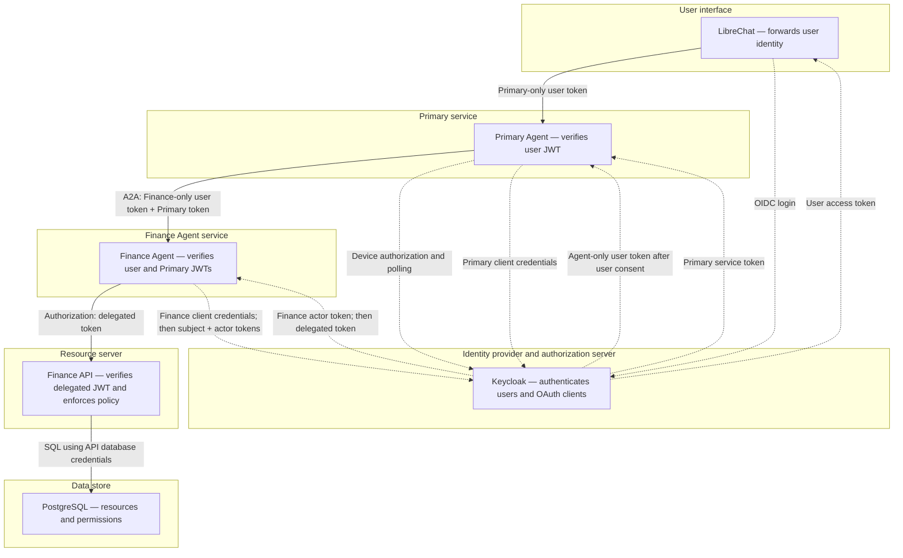

# Agent IAM Lab

A local proof of concept based on [docs/architecture.md](docs/architecture.md): LibreChat → Primary Agent → A2A → Finance Agent → Keycloak Client Delegation → Finance API → PostgreSQL.

## Getting started

1. Copy `.env.example` to `.env` and set `OPENROUTER_API_KEY`. Git ignores `.env`. The other values are **local demo credentials** and must match `keycloak/realm.json`.
2. Generate the local certificate with `./keycloak/create-local-cert.sh`, then start the services with `docker compose up -d --build`.
3. Open `http://localhost:3080` and sign in through Keycloak (`alice` / `alice-lab` or `bob` / `bob-lab`). This login gives LibreChat a user token for the Primary Agent only.
4. Select the `Agent Lab` endpoint and `finance-lab` model. On the first request, open the authorization link returned by Primary, approve the Finance delegation in Keycloak with the same account, then send your request again. Example prompts: “Read invoice 1”, “Read invoice 2”, “Approve payment 1”.

LibreChat uses the unmodified **v0.8.8** image in [compose.yaml](compose.yaml), with the multiarchitecture digest `sha256:5b706bcee1ca154a1e2987303aaeca0eb27f97919cccee4bb604226c2f8abf61` (Linux amd64 and arm64). The digest keeps the base image unchanged even if the tag changes; there is no local LibreChat patch. Substitution of `LIBRECHAT_OPENID_ACCESS_TOKEN` and `LIBRECHAT_BODY_CONVERSATIONID` was verified in this image using a synthetic OpenID context. To update LibreChat, choose a new tag and its digest, then verify both placeholders and the lab's OIDC login again.

Keycloak is available at `https://keycloak.localhost:8443` (admin console: `admin` / the value of `KEYCLOAK_ADMIN_PASSWORD`). LibreChat trusts the mounted self-signed certificate. Your browser must also trust `.local-certs/cert.pem` to avoid a local TLS warning.

## Reference versions

The combination below is the lab's reference configuration. The linked files define the installed versions; this repository has not validated other combinations. The [Security tests CI workflow](.github/workflows/security-tests.yml) checks Python, the agents, Keycloak, and the Finance API/PostgreSQL using the tests described under [Testing](#testing). It uses Caddy for automated Keycloak consent and checks native LibreChat/MongoDB login, renewal and the consent conversation. It does not cover browser rendering or trace reception by the telemetry collector.

| Component | Declared version or reference | Source and validation scope |
| --- | --- | --- |
| Python | 3.12; image `python:3.12-slim` | [Dockerfile.python](Dockerfile.python) and [CI](.github/workflows/security-tests.yml); Python and integration tests |
| Keycloak | `quay.io/keycloak/keycloak:26.8.0` | [compose.yaml](compose.yaml), `keycloak` and `keycloak-declarations` services; real consent and token exchange in CI. `token-exchange-delegation` remains a Preview feature |
| LibreChat | `registry.librechat.ai/librechat-ai/librechat:v0.8.8@sha256:5b706bcee1ca154a1e2987303aaeca0eb27f97919cccee4bb604226c2f8abf61` | [compose.yaml](compose.yaml); version and both placeholders verified in the image with a synthetic OpenID context. Native OIDC callback, renewal and chat with deterministic test agents are covered; browser rendering and real LLM conversations are not covered |
| Microsoft Agent Framework | `agent-framework-core==1.20.0`, `agent-framework-a2a==1.0.0b261002`, `agent-framework-openai==1.15.0` | [requirements.txt](requirements.txt); client/server transport and sessions tested. The A2A package is a prerelease; the CI chain selects tools without calling OpenRouter |
| A2A SDK and SSE server | `a2a-sdk==1.2.2`, `sse-starlette==3.0.3` | [requirements.txt](requirements.txt); A2A JSON-RPC V1 endpoints tested, without streaming validation |
| Python API | `fastapi==0.116.1`, `uvicorn==0.35.0`, `httpx==0.28.1`, `PyJWT[crypto]==2.15.1`, `psycopg[binary]==3.2.9` | [requirements.txt](requirements.txt); JWT, authorization, and HTTP calls tested |
| PostgreSQL | `postgres:16` | [compose.yaml](compose.yaml), Keycloak and Finance databases; used in CI integration |
| MongoDB | `mongo:8` | [compose.yaml](compose.yaml), LibreChat storage; used in the native server integration |
| Caddy TLS proxy | `caddy:2.11.7` | [compose.yaml](compose.yaml); used for Keycloak login/consent in CI integration |
| OpenTelemetry collector | `otel/opentelemetry-collector:0.162.0` | [compose.yaml](compose.yaml) and [otel-collector.yaml](otel-collector.yaml); CI validates the collector configuration, but trace reception is not covered by CI |
| OpenTelemetry libraries | SDK and OTLP HTTP exporter `>=1.39,<2`; FastAPI and HTTPX instrumentation `>=0.60b0,<1` | [requirements.txt](requirements.txt); version ranges rather than exact resolved versions |
| pytest | `8.4.2` | [requirements.txt](requirements.txt); CI test execution |

The unmodified LibreChat image is pinned by digest. The Python, PostgreSQL, and MongoDB base tags select a version line; exact Caddy, Keycloak, and OpenTelemetry tags can also be republished. Transitive Python dependencies and the OpenTelemetry ranges are not locked. A rebuild can therefore resolve newer patches: this list describes the tested references without guaranteeing identical builds or support for every release within a version line. The OpenRouter model is configurable in `.env` and is outside the combination validated by CI without an LLM.

### Updating the combination

1. Change the references in [requirements.txt](requirements.txt), [Dockerfile.python](Dockerfile.python), or [compose.yaml](compose.yaml), and the Python version in [CI](.github/workflows/security-tests.yml) if needed. Update this table in the same PR. For LibreChat, retain a tag and its multiarchitecture digest, then verify both lab placeholders.
2. Rebuild the Python images after changing dependencies. For third-party images, run `docker compose pull` before starting services to test the resolved references. Record their digests and resolved Python package versions in the PR validation notes when tags or ranges can change.
3. Run the full pytest suite, then both Keycloak integration scripts under [Testing](#testing). For Keycloak, also verify that the delegation declarations apply and the ALLOW/DENY cases remain unchanged. Framework or A2A updates must preserve caller identities and session isolation.
4. For LibreChat/MongoDB or the OpenRouter client, repeat OIDC login, consent, and an Alice/Bob conversation using the full stack and a valid OpenRouter key. For OpenTelemetry, verify that the collector receives traces. Describe completed and outstanding validation; CI without an LLM does not replace these checks.

## Request flow and trust boundaries

Each box below represents a separate trust boundary. Solid arrows show the finance request path; dotted arrows show identity and token issuance. A2A is the protocol between the two agents, rather than an authorization authority. See [docs/architecture.md](docs/architecture.md) for the delegation model and design decisions.



The Finance Agent first obtains its own actor token through client credentials. It then sends that token and the received user token to Keycloak for RFC 8693 exchange. Keycloak verifies the Finance client's identity and delegation permission and issues a token for `finance-api`, with the user's `sub` and the Finance Agent's `act`. The Primary service token authenticates the A2A caller; it is not the actor token used in this exchange.

| Boundary | Identity verified and enforcement |
| --- | --- |
| LibreChat → Primary | Primary verifies the user JWT signature, issuer, expiry, and `primary-agent` audience. Primary obtains a separate agent-only token after Keycloak consent and requires the same user subject; LibreChat cannot grant finance permissions |
| Primary → Finance Agent over A2A | Finance verifies the user JWT and the separate Primary service JWT, both with audience `finance-agent`. `Authorization` carries the user token; `X-Primary-Authorization` carries the service token, whose `azp` must be `primary-agent` |
| Keycloak → Finance Agent | Finance verifies the exchanged JWT for `finance-api`, checks that its `sub` matches the received user, and requires `act.client_id=finance-agent` |
| Finance Agent → Finance API | The API verifies the JWT, delegated actor, human subject, and required scope before accessing the database. It then enforces the intersection of user permissions, agent capabilities, and the resource department, and filters sensitive fields |
| Finance API → PostgreSQL | The API connects using its own database credentials. OAuth tokens are not forwarded to PostgreSQL; the API makes the authorization decision |

Each receiving service checks JWT signatures against Keycloak's JWKS. Agent/API calls carry tokens in authorization headers. At Keycloak's token endpoint, client credentials and the `subject_token`/`actor_token` values are sent as form fields, and access tokens are returned in JSON responses. Services keep tokens in request-local context variables, outside LLM messages.

The OAuth helpers do not log request or response bodies, and the configured HTTPX tracing does not capture bodies. The service boundaries above describe identity and authorization checks; Compose network connectivity is detailed below.

## Service boundaries

| Service | Compose networks | Responsibility |
| --- | --- | --- |
| LibreChat | frontend, identity-ui | OIDC authentication and forwarding the signed user access token |
| Primary Agent | frontend, orchestration, identity-primary, telemetry-primary | Token validation, Agent Framework orchestration, and authenticated A2A calls |
| Finance Agent | orchestration, finance, identity-finance-agent, telemetry-finance-agent | Finance tools, its own OAuth identity, and RFC 8693 token exchange |
| Finance API | finance, data, identity-finance-api, telemetry-api | JWT verification and final authorization by user, agent, and department |

The networks in [compose.yaml](compose.yaml) connect the following services:

| Network | Connected services |
| --- | --- |
| frontend | LibreChat, librechat-db, Primary Agent |
| orchestration | Primary Agent, Finance Agent |
| finance | Finance Agent, Finance API |
| data | Finance API, finance-db |
| identity-ui | LibreChat, Keycloak, keycloak-tls |
| identity-primary | Primary Agent, Keycloak |
| identity-finance-agent | Finance Agent, Keycloak, keycloak-tls |
| identity-finance-api | Finance API, Keycloak |
| identity-management | keycloak-declarations, Keycloak |
| identity-db | Keycloak, keycloak-db |
| telemetry-primary | Primary Agent, otel-collector |
| telemetry-finance-agent | Finance Agent, otel-collector |
| telemetry-api | Finance API, otel-collector |

Containers on the same network can directly reach their peers' listening ports. The Finance API is therefore reachable from the Finance Agent, `finance-db`, Keycloak, and `otel-collector`. The Primary Agent and LibreChat share no network with the Finance API or `finance-db`, and have no direct network path to those services. Connecting a service to multiple networks does not automatically provide routing between them.

Only LibreChat (`3080`), Keycloak (`8080`), and `keycloak-tls` (`8443`) publish host ports, all on `127.0.0.1`. The Finance API and databases publish no ports. No network is declared `internal: true`: this segmentation does not generally restrict outbound connections. These network boundaries limit direct connectivity; they do not decide authorization. For each business operation, the Finance API validates the delegated JWT and enforces user permissions, agent capabilities, and resource policies, regardless of the calling container.

Each agent service has its own image, endpoint, and deployment lifecycle. The Primary uses `A2AAgent`, and the Finance Agent exposes `A2AExecutor` through the official A2A SDK. `Authorization` carries the Finance-only user token to Finance; `X-Primary-Authorization` authenticates the A2A caller. The Finance Agent verifies both tokens, then exchanges the user token using its own actor token. Agent/API calls carry tokens in HTTP headers, while OAuth token endpoint calls carry credentials and tokens in request/response bodies as described above. Services keep tokens in request-local context variables and never include them in messages sent to OpenRouter. Uvicorn access logs are disabled. OpenTelemetry traces are sent to the local collector.

### Primary-owned consent and separate agent tokens

LibreChat sends one signed user token in `Authorization`, with audience `primary-agent`. It uses its native OIDC flow and existing header placeholders. No downstream token, refresh token or agent-specific OAuth scope is supplied by the UI.

Before calling the selected destination, Primary starts an OAuth Device Authorization Grant with scope `openid delegation:client:<agent-client-id>`. It returns a Keycloak authorization link as an ordinary OpenAI-compatible assistant response, without invoking the LLM or storing the link in its AgentSession. The user approves delegation in Keycloak, then repeats the request in the same conversation. Pending requests respect Keycloak's polling interval; refusal produces 403.

Primary validates the completed access token's signature, issuer, expiration, exclusive destination audience, `may_act` actor and matching user `sub`. Approval by a different account is rejected. Only this destination token enters the A2A context; the original login token is never forwarded. Finance rejects shared audiences and performs its own final exchange using its independent OAuth identity. Replaying the actual Finance-visible token at Primary returns 401.

Destinations are an operator-controlled allowlist in `PRIMARY_AGENT_DESTINATIONS`, a JSON object keyed by OAuth client ID. Each entry specifies `model`, `url` (the A2A endpoint), and `actor_scope` (an optional Keycloak audience scope for Primary's service token). For example, this `.env` setting adds a second destination:

```dotenv
PRIMARY_AGENT_DESTINATIONS='{"finance-agent":{"model":"finance-lab","url":"http://finance-agent:8000/a2a","actor_scope":"finance-agent-audience"},"reporting-agent":{"model":"reporting-lab","url":"http://reporting-agent:8000/a2a","actor_scope":"reporting-agent-audience"}}'
```

The default is Finance only. A second agent requires its own service, network connectivity, Keycloak client with service account and token exchange enabled, delegation permission, and optional audience scope assigned to Primary. Primary exposes configured destinations through `/v1/models`; LibreChat uses its native model catalog fetch. The selected model chooses the destination in this prototype. The LLM cannot choose an arbitrary URL or OAuth scope, and choosing a model does not grant delegation permission. The second integration fixture tests issuance for another agent; only Finance has a complete A2A/API implementation in this repository.

The bounded in-memory grant store is keyed by verified user, conversation and destination. Device codes and access tokens stay in Primary; refresh tokens returned by the device grant are discarded. Expiration or a Primary restart requires fresh consent. This prototype does not implement automatic renewal or shared state for multiple Primary replicas, and does not require reusable refresh tokens in LibreChat.

For an existing imported realm, enable **Consent required** and **OAuth 2.0 Device Authorization Grant** on `primary-agent`. Keep only `basic` as its default scope; assign `delegation:client` and `finance-agent-audience` as **Optional**. Keep LibreChat's `primary-audience` scope **Optional**, and use `OPENID_SCOPE=openid profile email primary-audience`. The import JSON does not update an existing realm automatically. Recreate LibreChat with the unmodified image, rebuild Primary and Finance, sign in again and start a new demo conversation. Session keys and A2A context IDs now include the destination; old prototype sessions are not migrated.

LibreChat passes its `conversationId` to the Primary Agent through `X-Conversation-ID`. The Primary stores the framework's complete `AgentSession` in the `primary-sessions` volume, keyed by destination, this ID and the verified user token's `sub`. Only the latest user message from each request is submitted to the session; the history in `request.messages` is not replayed. Conversations can therefore resume after a Primary Agent restart. Requests without a conversation ID are rejected.

The Finance Agent also stores an `AgentSession` in `finance-sessions`, keyed by the verified `sub` and the A2A conversation context. Only `SendMessage` is accepted at the A2A V1 endpoint; other task operations are rejected to prevent a client-supplied task ID from being used to read another user's session.

The transport uses `agent-framework-a2a`. `a2a-sdk` is pinned to the tested version, and `sse-starlette` is required by its server routes. These dependencies do not require a change to the FastAPI version.

Keycloak configuration is declared in `keycloak/realm.json`, `keycloak/delegation-policy.json`, and `keycloak/delegation-permission.json`. The small `keycloak/apply-declaration.sh` adapter applies the latter two declarations after import: Keycloak creates the FGAP V2 `admin-permissions` system client at runtime, so its ID must be resolved before submitting the declarations. The adapter is idempotent and contains no security rules outside the JSON files.

## Demo policy

- Alice: Finance department; invoice read/write and payment read/approval permissions.
- Bob: HR department; payment read permission only.
- Finance Agent: invoice read/write and payment read capabilities; no approval capability.
- The Finance API validates the token before looking up any invoice or payment: a missing or invalid token receives the same 401 response for an existing or missing ID. Delegation claims (`act`, human subject) and the required scope are also checked before any database access; missing or invalid claims produce the same 403 response for both IDs.
- The Finance API checks the intersection of delegated token scopes, user permissions, agent permissions, and the object's department. `bank_account` is never returned to this role.

## Testing

Run the following commands from the repository root. Choose the test level according to the change:

| Level | Coverage | Prerequisites | Expected result |
| --- | --- | --- | --- |
| Quick | Primary responses, A2A transport, and sessions | Python 3.12 and `requirements.txt` | All tests pass; simulated identities and agents |
| Acceptance | Finance API decisions, scopes, departments, and fields | Same Python environment | All tests pass; real JWTs signed with a test key, simulated database |
| Keycloak integration | Automated browser consent, RFC 8693 exchange, and API decisions | Docker Compose, local certificate, Keycloak and Finance services | Script success message; real Keycloak tokens and PostgreSQL |

### Quick and acceptance tests

No Compose services, `.env`, secrets, or OpenRouter key are required. Install the dependencies in a Python 3.12 environment:

```sh
python3.12 -m venv .venv
. .venv/bin/activate
python -m pip install -r requirements.txt
PYTHONPATH=. python -m pytest -q tests/test_primary_chat.py tests/test_a2a_transport.py
PYTHONPATH=. python -m pytest -q tests/test_acceptance.py
```

`tests/test_acceptance.py` covers the seven outcomes in `docs/architecture.md`, as well as missing scopes and an inconsistent `username` / `sub` combination. A2A transport and sessions are tested without calling an LLM. To run the full suite discovered by pytest:

`tests/test_oauth_telemetry.py` exercises client credentials, token exchange and device authorization/polling against a local HTTP server with real HTTPX instrumentation, captures DEBUG logs and spans, and checks that synthetic secrets never appear in telemetry or returned errors. It covers successful exchanges, OAuth refusals, and transport failures. It also checks that inbound and outbound `Authorization` and `X-Primary-Authorization` headers are redacted when header capture is enabled, while preserving other configured redaction fields and useful correlation headers. This test uses no real credentials or external network.

```sh
PYTHONPATH=. python -m pytest -q tests
```

You can also use the project image. **Rebuild the image** after changing `requirements.txt` so the installed versions match the repository. Compose requires an `OPENROUTER_API_KEY` value to load its configuration; a placeholder is sufficient to build the image and run these tests.

```sh
OPENROUTER_API_KEY=test-placeholder docker compose build finance-agent
docker run --rm --network none -v "$PWD":/src:ro -w /src -e PYTHONPATH=/src \
  agent-identity-finance-agent pytest -q -p no:cacheprovider tests
```

Expect an `N passed` summary and exit code 0; the count changes as the suite grows. The read-only mount and `--network none` verify that tests remain self-contained. This level uses no real Keycloak tokens.

### Integration with real Keycloak

Use the repository's realm and **local demo credentials**. Ports 8080 and 8443 must be available. The commands below do not start LibreChat or OpenRouter conversations:

```sh
export OPENROUTER_API_KEY=test-placeholder
./keycloak/create-local-cert.sh
docker compose up -d --build keycloak-tls finance-api
docker compose build finance-agent
```

Wait for `keycloak-declarations` to finish with exit code 0 and for the Finance API to become ready. Check readiness with:

```sh
docker compose ps -a
curl --fail --silent --show-error --cacert .local-certs/cert.pem \
  --resolve keycloak.localhost:8443:127.0.0.1 \
  https://keycloak.localhost:8443/realms/lab/.well-known/openid-configuration
docker compose exec -T finance-api python -c \
  'import urllib.request; urllib.request.urlopen("http://localhost:8000/healthz", timeout=2)'
```

Then run the script from a temporary Finance Agent container connected to the required networks:

```sh
docker compose run --rm --no-deps -v "$PWD":/src:ro -w /src -e PYTHONPATH=/src \
  -e LIBRECHAT_CLIENT_SECRET=lab-librechat-secret \
  finance-agent python tests/e2e_delegation.py
```

Expect `Live Keycloak delegation and Finance API checks passed` and exit code 0. The script performs Alice's login and consent, verifies the real token exchange, an authorized read without the bank account, rejection of another department, rejection of user-only and agent-only tokens, and rejection of payment approval. It prints no tokens.

`OIDC_ISSUER`, `KEYCLOAK_INTERNAL`, `FINANCE_API_URL`, and `FINANCE_CLIENT_SECRET` are supplied by `compose.yaml`. `LIBRECHAT_CLIENT_SECRET` is explicitly passed to the test container; if you customize demo secrets, update this value and `.env` to match the imported realm. The script uses the repository's Alice account and the certificate mounted at `/src/.local-certs/cert.pem`.

After testing, `docker compose stop` stops services without deleting data. Use `docker compose down -v` only for a test project whose data can be deleted; it also resets databases and sessions.

### Full Primary → A2A → Finance chain

The full-chain test uses the real Primary and A2A endpoints, Keycloak, the Finance API, and PostgreSQL. A test-only driver selects tools deterministically: it checks delegation and ALLOW/DENY decisions without testing LLM reasoning or calling OpenRouter. Use the override below only for tests. Wait for `/healthz` to become available on both agents and the Finance API before running the script; CI checks these endpoints. A placeholder `OPENROUTER_API_KEY` value is sufficient for Compose.

```sh
docker compose -f compose.yaml -f tests/compose.e2e.yaml up -d --build keycloak-tls primary-agent
docker compose -f compose.yaml -f tests/compose.e2e.yaml run --rm --no-deps \
  -v "$PWD":/src:ro -w /src -e PYTHONPATH=/src \
  -e LIBRECHAT_CLIENT_SECRET=lab-librechat-secret \
  finance-agent python tests/e2e_chain.py
```

Expect `Live Primary → A2A → Keycloak → Finance API checks passed (ALLOW and DENY)`. Cases cover Alice's authorized read, bank account masking, and rejection based on department, agent capability, and user permissions. CI runs this script after the direct delegation checks.

### Multiple destinations and native LibreChat integration

With the test agents running, run the second-destination and refusal checks:

```sh
docker compose -f compose.yaml -f tests/compose.e2e.yaml run --rm --no-deps \
  -v "$PWD":/src:ro -w /src -e PYTHONPATH=/src \
  -e LIBRECHAT_CLIENT_SECRET="${LIBRECHAT_CLIENT_SECRET:-lab-librechat-secret}" \
  finance-agent python tests/e2e_destinations.py
```

This test uses demo admin credentials to add a reporting-client fixture and delegation permission to the isolated test realm. It verifies another configured destination, explicit refusal and approval by the wrong user. The reporting fixture tests token issuance; Finance's full-chain test covers real A2A and API decisions. Run these tests against an isolated demo project.

The native LibreChat test uses the unmodified pinned image, real MongoDB, the OAuth callback and app session, model catalog, conversation stream, Primary-owned consent and the Finance chain:

```sh
docker compose -f compose.yaml -f tests/compose.e2e.yaml up -d librechat
docker compose -f compose.yaml -f tests/compose.e2e.yaml exec -T \
  librechat node /src/tests/e2e_librechat_ui.cjs
```

Run the destination fixture first and wait for LibreChat's root URL to respond. The test temporarily shortens the demo LibreChat client's access-token lifetime, waits just over two minutes for expiry beyond its refresh-publication cache, and restores the configuration afterward. It covers the native server flow, not browser rendering or a real LLM.

### CI and validation scope

The [Security tests CI workflow](.github/workflows/security-tests.yml) runs two jobs on every PR and on `master`: `Identity and authorization` runs the full pytest suite on Python 3.12; `Keycloak delegation integration` starts the required Compose services, then runs the direct and full-chain integration scripts and the multiple-destination and native LibreChat checks. It uses demo credentials and a placeholder OpenRouter key, with no GitHub secrets or LLM calls. The native flow starts the unmodified LibreChat server and MongoDB.

Quick and acceptance tests do not prove that consent or token exchange work with Keycloak: run integration tests for OAuth, realm, or delegation changes. The direct integration script does not cover LLM reasoning. An interactive conversation demo requires a real OpenRouter key in `.env` and the full stack.

## Vulnerability scans

Run `./scripts/scan-vulnerabilities.sh` with Docker and Compose available. The command builds the Python images in the separate `agent-identity-scan` Compose project, then scans `requirements.txt` and all images returned by `docker compose config --images`, removing duplicates. It starts no services and uses a placeholder OpenRouter key without reading `.env`. Network access to registries and vulnerability databases is required.

The script pins Trivy **0.75.0** by digest. Each run writes JSON reports and readable tables to a new `.scan-reports/run-*` subdirectory, ignored by Git; its path is printed. `images.txt` lists the inventory, and `image-N.txt` associates each report with its image. The JSON files contain metadata for the scanned images; `scanner.txt` and `scanned-at.txt` record the scanner and date. Image tags not pinned by digest and vulnerability databases can change, so the same command may produce different results over time.

The [Vulnerability scans workflow](.github/workflows/vulnerability-scans.yml) runs the same command when dependencies or images change, every Monday, and on demand. In GitHub Actions, open the workflow run and download the `vulnerability-reports` artifact, retained for 30 days. Partial reports are also uploaded if a scan fails. Detected vulnerabilities do not fail the job (`--exit-code 0`); build, registry, or scanner errors do. The workflow also publishes a readable **Trivy vulnerability review** in the GitHub Actions run's **Summary**: per-component CRITICAL/HIGH counts, known-fix counts, every CRITICAL advisory, and up to 25 fixable HIGH advisories with installed/fixed versions. It flags missing or invalid reports as **SCAN INCOMPLETE** instead of showing a misleading zero. Review the Summary first; the artifacts are for deeper investigation. For pull requests opened from branches in this repository, a separate read/write-permission-limited job posts or updates a single PR comment linking to the latest run summary. Fork pull requests do not receive this automated comment because GitHub gives their `pull_request` workflows read-only tokens; the scan summary remains accessible from the Actions run. This scan inventories the lab without publishing images or acting as a production deployment gate.

Review critical and high findings first, along with their fixed versions and relevance to the lab. For a Python dependency, update `requirements.txt`; for a third-party image, update its tag and optional digest in Compose. Rerun the scan, identity and authorization tests, and Keycloak integration if the change affects OAuth. If no fix is available or a finding does not apply, document the decision, rationale, and review date in an issue; do not suppress results globally.

The [Trivy scan of `requirements.txt`](https://trivy.dev/docs/latest/guide/coverage/language/python/) covers direct dependencies pinned with `==`, not transitive dependencies or version ranges. Python image scans complement this inventory with the packages actually installed, including transitive dependencies and OpenTelemetry. No findings does not guarantee that no vulnerabilities exist.

## V1 limitations

The UI → Primary connection uses LibreChat's custom endpoint and its `LIBRECHAT_OPENID_ACCESS_TOKEN` and `LIBRECHAT_BODY_CONVERSATIONID` placeholders; support was verified in the v0.8.8 image pinned above. SQLite session storage assumes a single instance of each agent service. A2A calls cover synchronous JSON-RPC `SendMessage` text messages; persistent tasks, streaming, and push are not implemented. Demo secrets in the imported realm are static: this Compose setup is intended for a local workstation, not a shared deployment.

## License

This project is distributed under the [Apache-2.0](LICENSE) license.

Copyright 2026 Thibaut Tauveron.
