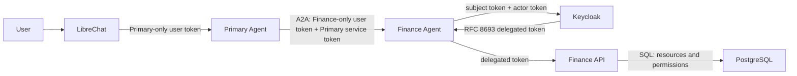
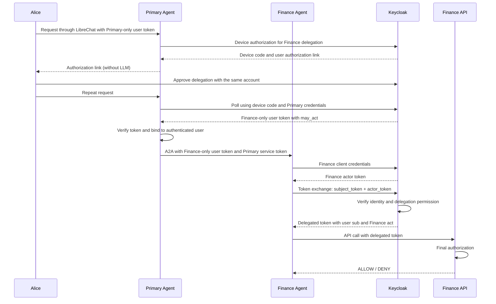

# Agent IAM Lab Architecture

This document describes the design decisions behind the implemented lab. The [README](../README.md) covers setup, reference versions, and tests; the [threat model](threat-model.md) describes security guarantees and limitations.

## 1. Objective

The lab demonstrates delegated agent authorization:

> An agent acts on behalf of a user, but must never automatically inherit all of that user's authority.

Every action must answer two questions:

- **Which user requested the action?**
- **Which authenticated agent is acting for that user?**

Effective access follows least privilege:

```text
effective access
=
user permissions
∩
agent permissions
∩
resource-specific policy
```

The implemented use case is a **mock Finance API**. Kubernetes remains a possible advanced exercise outside the current PoC.

## 2. Reference model

The reference model uses **delegated permissions / On-Behalf-Of**:

```text
User
    +
Agent
    ↓
OAuth 2.0 Token Exchange / OBO
    ↓
Delegated token
    ↓
Resource server
    ↓
Final authorization
```

The lab uses **RFC 8693**. A simplified delegated token looks like this:

```json
{
  "sub": "aaaaaaaa-aaaa-aaaa-aaaa-aaaaaaaaaaaa",
  "preferred_username": "alice",
  "act": {
    "client_id": "finance-agent",
    "sub": "<Finance service account identifier>"
  },
  "aud": "finance-api",
  "scope": "invoices.read invoices.write"
}
```

- `sub`: the human user's stable identifier, distinct from their username.
- `preferred_username`: the username associated with `sub` in the employee table.
- `act`: the authenticated agent performing the action.
- `aud`: the resource the token is intended for.
- `scope`: the capabilities delegated to the agent for that resource.

The token represents a **delegation relationship**, rather than a new user identity.

## 3. Implemented architecture



### Components

| Component | Responsibility |
| --- | --- |
| **Primary Agent** | Receives the user's request and delegates the task to the appropriate agent. |
| **Finance Agent** | Handles finance requests and calls the required tools/APIs using its own identity. |
| **Keycloak** | Authenticates users and agents, controls delegation, and issues RFC 8693 tokens. |
| **Finance API** | Acts as the resource server, verifies delegated tokens, and enforces final authorization. |
| **LLM** | Provides reasoning only; it is never a source of identity or authorization. |

LibreChat forwards a signed user token for `primary-agent`. Primary initiates a separate Keycloak device authorization request for the configured destination and returns a consent link without invoking the LLM. Once the user approves and repeats the request, Primary verifies the resulting token's exclusive agent audience, delegation actor and identical user `sub`, then forwards only that token. Finance validates the user and Primary service tokens for `finance-agent`, requires `azp=primary-agent` for the A2A caller, and checks that its own exchange preserves the user's `sub` and contains `act.client_id=finance-agent`.

Destinations are configured in Primary, not in a LibreChat patch. Each has a model identifier, A2A URL and Keycloak audience scope for the Primary service token. Model selection chooses a configured destination; Keycloak consent and delegation permissions decide whether it can act for the user. Grant and conversation state are isolated by user, conversation and destination. The prototype discards refresh tokens, so expiry or restart requires new consent. It does not implement automatic multi-agent planning or shared grant storage. See the [setup and migration instructions](../README.md#primary-owned-consent-and-separate-agent-tokens).

Both agents persist SQLite sessions keyed by the verified `sub` and conversation or context ID. The Primary passes the context through `A2AAgent`; Finance exposes `A2AExecutor`. Only `SendMessage` is accepted. The services and their OAuth identities remain independent.

## 4. Identities

### User

Alice has her own business permissions, including:

```text
invoices.read
invoices.write
payments.approve
```

These permissions can be more precise than roles alone: Alice can read invoices only within her department, and only permitted fields.

### Agent

The `finance-agent` has an independent identity and a permission ceiling:

```text
invoices.read
invoices.write

NOT:
payments.approve
users.admin
```

Compromising an agent must not turn a user's elevated privileges into elevated privileges for that agent.

## 5. Delegation flow



The Finance Agent must never fabricate `sub`, `act`, roles, or scopes.

## 6. Where permissions intersect

Keycloak establishes the delegation relationship and can constrain the agent's broad capabilities.

The **Finance API remains responsible for final authorization**, because it knows the resources and business rules.

```text
Alice:
  invoices.read = Finance department only
  invoices.write = yes
  payments.approve = yes

Finance Agent:
  invoices.read = yes
  invoices.write = yes
  payments.approve = no
```

| Action | Result |
| --- | --- |
| Read a Finance invoice | ALLOW |
| Modify a Finance invoice | ALLOW |
| Approve a payment | DENY — the agent lacks this capability |
| Read an HR invoice | DENY — Alice cannot access this resource |

Field restrictions also apply: Alice can read `invoice.amount`, but cannot read `invoice.bank_account`. Even when the agent can read invoices, the Finance API returns only the permitted fields.

```text
Keycloak
→ identity + delegation + agent capability ceiling

Resource server
→ user's actual permissions on the resource
→ final intersection
```

## 7. Keycloak responsibilities

Keycloak provides:

- Human authentication as the identity provider.
- OAuth identities for agents.
- Authorization server and token exchange services.
- RFC 8693 delegated token issuance.
- Control over an agent's permission to act for a user.
- Audience and scope constraints for the agent.

The lab uses **Client Delegation / `act` in Keycloak 26.8.0**, with `token-exchange-delegation` and `parameterized-scopes` enabled in [compose.yaml](../compose.yaml). This feature is Preview in the version used.

This dependency is deliberate: the lab explores the delegation model rather than providing a production banking platform.

## 8. Finance API responsibilities

The Finance API:

1. Validates the token signature.
2. Checks `iss`, `aud`, expiration, `sub`, and `act`.
3. Verifies that the token scope permits the operation.
4. Enforces the user's business permissions.
5. Applies resource and field restrictions.
6. Allows or denies the operation.
7. Audits both the user and the agent for business policy decisions.

JWT authentication, delegation claims, and the required scope are checked before any resource lookup. The API then applies user and agent permissions and the resource's department. Rejection produces HTTP 401 or 403; an authorized operation returns data or the modification result.

The current audit is a business decision log line, for example:

```text
user=alice agent=finance-agent action=invoices.read department=finance decision=allow
```

It does not include the resource ID or record every early authentication rejection. Tokens stay outside LLM messages. They travel in agent/API request headers and in OAuth request/response bodies exchanged with Keycloak. OAuth helpers do not log these bodies; telemetry tests verify that logs and spans contain no secrets and that authorization headers are redacted when header capture is enabled.

## 9. Initial use case

The finance application is deliberately small. It implements two resource types:

```text
Invoice
Payment
```

Available capabilities are:

```text
invoices.read
invoices.write
payments.read
payments.approve
```

The model is demonstrated through department and resource restrictions, sensitive field filtering, and an action (`payments.approve`) that the agent cannot perform.

The goal is to demonstrate delegation and least privilege, rather than build an ERP.

## 10. Enterprise model

The same pattern can extend to multiple applications:

```text
                   Identity / Authorization Platform
                              Keycloak
                                 │
                      OBO / delegated tokens
                                 │
            ┌────────────────────┼────────────────────┐
            │                    │                    │
      Finance Agent        Claims Agent        HR Agent
            │                    │                    │
      Finance API          Claims API             HR API
```

Each application team retains responsibility for its resource-specific business policies. The IAM/security platform team provides agent identity conventions, delegation standards, audience/scope conventions, Keycloak configuration, validation patterns or shared middleware, and audit requirements.

Application teams can reuse OAuth and delegation infrastructure, while their resource servers must still enforce delegated access correctly.

## 11. Non-goals

The PoC does not aim to build:

- A universal IAM platform.
- A generic policy engine.
- A custom authorization gateway.
- A full ERP.
- A complete Kubernetes integration.
- A production multitenant solution.

Its core objective is to demonstrate:

```text
human identity
+
agent identity
+
RFC 8693 delegation
+
downstream authorization
=
least-privilege agent access
```

## 12. Possible Kubernetes extension

Kubernetes remains a possible advanced exercise. Its traditional RBAC model does not directly consume the RFC 8693 `sub + act` relationship to compute:

```text
user permissions ∩ agent permissions
```

A Kubernetes integration could be a separate exercise. It is neither implemented nor validated in this repository and is outside the finance PoC.

## 13. PoC acceptance criteria

The acceptance tests cover:

```text
Authorized user + authorized agent
→ ALLOW

Authorized user + unauthorized agent
→ DENY

Unauthorized user + authorized agent
→ DENY

User resource/field restriction
→ respected even through the agent

User token alone
→ insufficient

Agent token alone
→ insufficient

Delegated token with wrong actor/audience
→ DENY
```

The intended result is a model simple enough to understand while demonstrating the delegated authorization decisions that an application must enforce.
